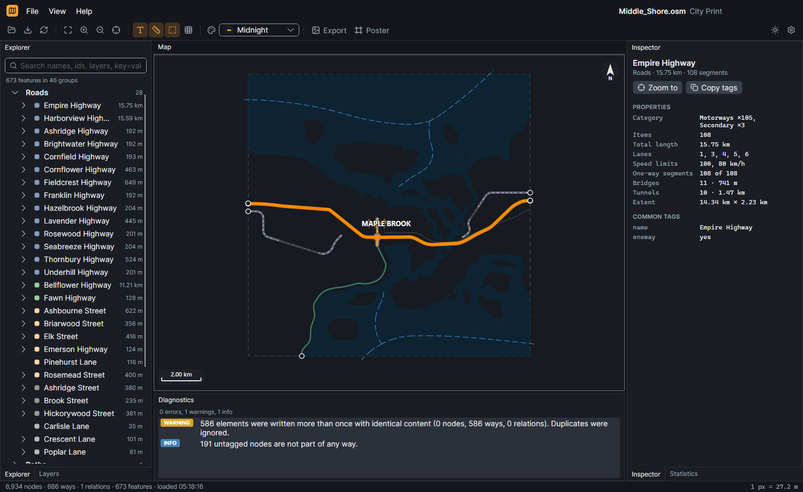
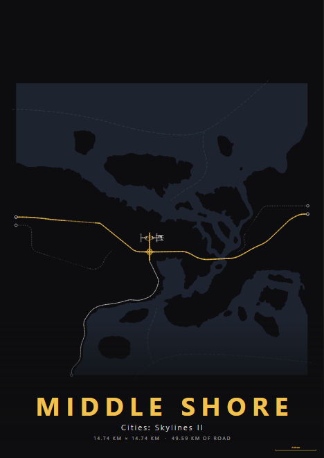

# City Print

A desktop app for exploring and printing your **Cities: Skylines II** city. It reads exports from the [OSM Export](https://mods.paradoxplaza.com/) and [Carto](https://mods.paradoxplaza.com/) mods, shows them on a fast interactive map, and turns them into posters and wallpapers.



## Features

- **Explore.** Streets are grouped by name, so a highway made of 100 segments shows up as one entry with its total length, lanes, speed limits, bridges and tunnels. Search by name, id, layer or `key=value` tag.
- **Carto exports.** Open the Carto mod's GeoJSON export, with water from its Depth GeoTIFF. Roads are drawn at their real outlines, buildings and points of interest are colour-coded by type, and you can show zoning and districts. Click a building to see its address, residents and employees.
- **Inferred features.** City Print guesses parks (empty blocks enclosed by streets) and shopping streets (streets lined with commercial lots). One switch in the View menu shows or hides them.
- **Map themes.** Classic, Midnight, Blueprint, Paper, Noir and Transit (which fades everything except your rail, tram, subway and ferry lines).
- **Posters.** Pick a paper size (A4 to 24×36 in, plus wallpapers at Full HD, 2K, 4K, ultrawide and phone sizes such as the Pixel 9a), a layout (Gallery, Full-bleed, Minimal), a theme, labels, a scale bar and a transit legend. Export PNG at any DPI or SVG for Inkscape and Illustrator.
- **Map tools.** Layers you can switch on and off, real road widths, the 23×23 tile grid, the map edge, diagnostics for the export file, and statistics.
- **Comfortable.** Dark and light themes, reloads automatically when you export again from the game, remembers recent files.



## Download

Get the latest build from [Releases](../../releases). Builds are self-contained, so you don't need to install .NET.

| System | File |
| --- | --- |
| Windows 10/11 (x64) | `CityPrint-win-x64.zip`: unzip and run `CityPrint.exe` |
| Linux (x64) | `CityPrint-linux-x64.tar.gz`: extract and run `./CityPrint` |
| macOS, Apple Silicon | `CityPrint-osx-arm64.tar.gz` |
| macOS, Intel | `CityPrint-osx-x64.tar.gz` |

The builds aren't code-signed. On Windows, SmartScreen may warn you the first time: choose **More info → Run anyway**. On macOS, extract the archive, then run this once in Terminal before opening the app:

```sh
xattr -dr com.apple.quarantine "City Print.app"
```

## Using it

1. In the game, export your city with the OSM Export mod or the Carto mod. For Carto, choose GeoJSON and GeoTIFF with the WGS84 projection.
2. In City Print, use **File → Open game export** (Ctrl+G), **Open Carto export** (Ctrl+Shift+G) or **Open** (Ctrl+O). You can also drop a file or the Carto folder on the map.
3. Click streets on the map or in the Explorer. Press **Ctrl+P** to make a poster.

| Shortcut | Action |
| --- | --- |
| Ctrl+O / Ctrl+G / Ctrl+Shift+G | Open a file / the newest OSM Export file / the Carto export |
| F5 | Reload |
| F, +, − | Fit, zoom in, zoom out |
| Z | Zoom to the selection |
| Ctrl+E | Export the current view as PNG |
| Ctrl+P | New poster |
| Ctrl+, | Settings |

Posters can also be made from the command line:

```sh
CityPrint city.osm --export-poster poster.png --poster-theme noir --paper A2 --layout FullBleed --labels --legend
```

## Building from source

You need the [.NET 10 SDK](https://dotnet.microsoft.com/download).

```sh
dotnet run --project src/CityPrint.App
```

## License

City Print is open source under the [Apache License 2.0](LICENSE). You can use, change and share it, including your changes. The name "City Print" and its logo aren't covered by the license, so if you share a modified version please give it its own name. See [TRADEMARKS.md](TRADEMARKS.md).

City Print is a fan project and isn't affiliated with Colossal Order or Paradox Interactive. Icons are from [Lucide](https://lucide.dev); see [THIRD-PARTY-NOTICES.md](THIRD-PARTY-NOTICES.md).

Made with ♥ by Aurora Tejeda.
